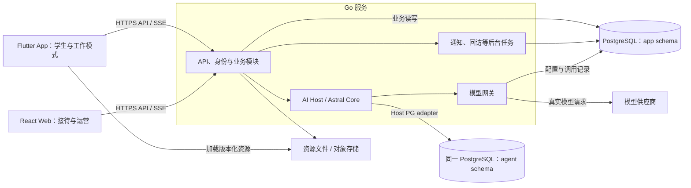
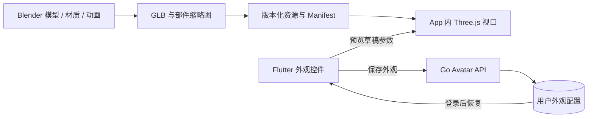

# 心灵港湾总体架构

2026 年 11 月 14 日 · 架构设计

本文基于[产品设计文档 V1.1](../心灵港湾-产品设计文档.md)，说明目标系统如何组织。页面和业务行为以产品文档为准，下面的模块与数据关系供实现使用。

## 文档导航

- 本文介绍系统组成、客户端、仓库和运行方式。
- [后端与数据架构](02-后端与数据架构.md)介绍业务模块、主要数据关系与关键流程。
- [AI 与模型网关](03-AI与模型网关.md)介绍 Astral Host、PG Store、流式交互、额度和调用记录。
- [领域词汇表](CONTEXT.md)统一账号、工作身份、预约、会话和回访等概念。

## 1. 系统组成

产品采用 Flutter App、React Web 工作台和一个 Go 模块化单体。Go 服务承载业务 API、AI Host、模型网关和后台任务，PostgreSQL 保存业务与 AI 运行数据。角色模型、图片等文件通过统一资源接口提供。



图中的 Go 模块在同一个工程和进程内运行。后台任务使用该进程内的定时循环读取数据库任务表。单实例运行即可覆盖当前单校产品的完整功能。

## 2. 各部分负责什么

| 部分 | 职责 |
| --- | --- |
| Flutter App | 学生与工作模式、表单与列表、聊天界面、3D 助手、草稿和资源缓存 |
| React 工作台 | 接待、运营、批量排班、人员管理、模型配置与统计 |
| Go API | 登录、授权、校验、业务状态变更、数据查询、消息与 AI 事件出口 |
| AI Host | 会话归属、运行控制、Astral 接入、历史恢复和业务工具 |
| 模型网关 | 供应商与用途配置、真实调用、超时、用量与结果记录 |
| PostgreSQL | 账号、业务记录、通知、配置、额度及 Astral 历史和执行状态 |
| 资源存储 | GLB、贴图、角色缩略图及用户头像 |

App 和 Web 的页面差异由客户端处理。服务端针对当前账号、已获授权的角色和对象参与关系判断可执行操作。修改前端的模式或路由不会改变账号权限。

## 3. Monorepo 组织

产品上游是 [oines/xlgw-mono](https://github.com/oines/xlgw-mono)。

```text
xlgw-mono/
  apps/
    mobile/                       Flutter 学生与工作人员 App
    console/                      React 和 TypeScript 工作台
  backend/
    cmd/harbor/                   HTTP 服务和到期任务
    internal/harbor/              业务 API，按能力划分文件
    internal/ai/                  Astral Host、PostgreSQL Store、工具和模型网关
    migrations/                   app 和 agent 数据库迁移
  packages/contracts/             HTTP、事件和资源清单契约
  art/                            Three.js 视口、模型授权与发布脚本
  docs/                           产品与架构文档
```

Astral Core 在独立仓库维护，通过 Go module 固定提交接入。当前核查基线为 `4e2310b`。PG adapter 位于产品 Host，使用 Core 公开契约实现。

## 4. 客户端组织

Flutter 按账号、陪伴、角色、社区、消息、校内服务和工作空间划分功能。页面管理各自的交互状态，使用同一 HTTP Client。身份与主题在 App 入口维护，陪伴、社区、接待与个人设置分别管理业务页面。

登录后，服务器返回账号资料和可用角色。学生进入个人空间，老师与朋辈进入工作空间，多身份账号可切换。草稿、未读和页面状态按账号及空间区分，退出登录清理私有缓存。工作身份撤销后，客户端重新加载可用入口。

Web 按工作台页面划分模块，远端数据缓存与表单草稿各自管理。App 和 Web 使用相同接口、业务 ID 和状态名称，能互相看到已经提交的变化。

接口通过 `packages/contracts` 固定请求、响应与事件格式。页面不得根据模型文字或本地假计数推断业务已经成功。

## 5. 3D 助手资源链路



Flutter 控件负责分类、滑杆和保存，Three.js 负责旋转、形变、材质和动画。二者通过固定消息协议通信，例如加载资源、设置外观、切换动作、报告加载结果。动作由客户端状态驱动，只有用户保存的外观和偏好需要写入服务端。

Manifest 描述资源版本、部件 ID、十项参数的范围和可用动画。用户配置记录对应版本及参数。资源使用不可变路径发布，已经保存的外观仍能找到原资源。App 可缓存基础包，后台暂停渲染，加载失败时仍可使用文字和业务页面。

## 6. 运行和部署

开发环境可通过 Compose 启动 PostgreSQL 和 Go 服务，Web 使用开发服务器，Flutter 连接同一 API。正式运行由 HTTPS 入口提供 Web 静态文件、`/api/v1` 和事件流。SSE 路径关闭代理缓冲。

资源存储先支持持久本地目录，通过同一个接口也可接对象存储。模型密钥、数据库连接、资源路径和加密密钥通过服务端配置提供。公开 GLB 与私人附件采用各自的访问规则。

启动时执行数据库迁移、加载基础角色和问卷模板，并提供一次性管理员初始化。学校信息、老师和朋辈由运营创建，业务内容通过实际操作产生。模型服务未配置时，AI 页面展示真实的未启用状态。

Go 进程持有当前运行的 AI 句柄与全局并发名额，数据库保存可恢复的状态。退出时取消并等待本进程执行，启动时核查遗留运行及额度记录。数据库与资源目录使用持久卷，并提供一次备份与恢复的操作说明。
