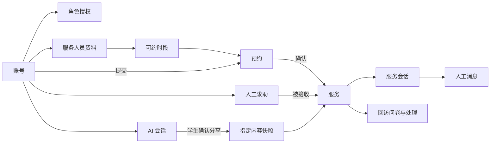

# 后端与数据架构

依据[产品设计文档](../心灵港湾-产品设计文档.md)。整体结构见[总体架构](01-总体架构.md)，术语见[领域词汇表](CONTEXT.md)。

## 1. 模块边界

一个 Go 服务按业务目录组织。HTTP Handler 负责参数与响应，业务 Service 处理权限、状态和事务，Repository 提供数据库访问。模块之间通过明确的服务方法协作，后台任务也调用同样的业务方法。

| 模块 | 主要对象 | 职责 |
| --- | --- | --- |
| Identity | 用户、登录会话、角色、学校、服务人员 | 注册登录、授权、身份切换、人员资料 |
| Care | 时段、预约、服务、回访、跟进、求助 | 学生与工作人员之间的接待流程 |
| Messaging | 人工会话、参与者、消息、私聊申请、已读位置 | 服务文字交流和同学私聊 |
| Community | 帖子、评论、共鸣、举报、屏蔽 | 社区内容和互动 |
| Avatar | 角色模板、资源版本、用户外观 | 可用部件、外观校验与保存 |
| AI | AI 会话、业务输入、运行映射 | 所有人校验、Astral 执行与历史 |
| Gateway | 供应商、模型用途、额度、调用记录 | 模型连接、限额、调用统计 |
| Operations | 配置、应用反馈、操作记录 | 运营页面和真实数据汇总 |
| Notifications | 通知、任务 | 消息中心、延迟回访、状态过期与重试 |

产品页面按用户任务组织，服务端模块按业务对象组织。App 工作模式和 Web 可以调用同一个预约确认方法，得到相同状态。

## 2. 身份与权限

一个用户对应多个角色授权，工作身份绑定到同一账号。服务人员资料包含接待介绍、方式和老师或朋辈类别，朋辈资料关联指导老师。拥有人员介绍与拥有接待权限是两个需要同时校验的条件。

账号密码登录后签发随机登录凭证，服务端保存凭证摘要、账号和有效状态。App 通过 Bearer 携带凭证，Web 可使用同源 HttpOnly Cookie，Cookie 写请求同时验证来源及 CSRF。权限在每次业务请求时从服务端确认，账号停用或角色撤销可以立即生效。

对象访问遵循三个判断。

1. 账号是否有效、是否具有本次动作需要的角色。
2. 对象是否属于当前学校，当前用户是否为所有人、参与者或负责人。
3. 对象状态是否允许动作，例如已取消预约不能再开始服务。

身份切换只改变客户端工作空间。服务端仍按授权和对象关系判断权限。私人 AI 历史、服务内容和举报证据各有明确访问入口。

## 3. 主要数据关系

PostgreSQL 使用 `app` 保存业务，`agent` 保存 Astral Store 数据。以下为逻辑数据分组，字段细节由迁移文件表达。

| 分组 | 主要表或对象 | 关系 |
| --- | --- | --- |
| 身份 | users、auth_sessions、user_roles、schools | 用户关联学校与角色，登录会话关联用户 |
| 人员 | service_profiles | 关联用户，朋辈关联指导老师 |
| 接待 | availability_slots、appointments、care_services | 人员发布时段，学生申请预约，确认后建立服务 |
| 交流 | conversations、conversation_members、messages、read_positions | 服务或获准私聊关联会话，会话具有限定参与者 |
| 私聊 | chat_requests、blocks | 交流申请被接受后建立同学私聊 |
| 回访 | survey_templates、followups、followup_answers、followup_actions | 服务关联一份正式回访，答案与处理分别保存 |
| 求助 | help_requests、transfers、care_actions | 求助由人员接收，转交和联系有记录 |
| 社区 | posts、comments、resonances、reports | 评论和共鸣关联帖子，举报关联具体内容 |
| AI 业务 | ai_conversations、ai_admissions | 业务会话关联所有人和 Astral 会话，受理记录关联业务输入与额度 |
| 分享 | ai_shares | 内容快照、来源、接收人、服务、有效期与撤回状态 |
| 助手 | avatar_templates、avatar_asset_versions、user_avatars | 用户外观引用稳定的模型和参数版本 |
| 模型运营 | model_connections、model_profiles、quota_policies、quota_usage、model_calls | 用途选择连接，逻辑额度和物理调用分别统计 |
| 其他运营 | notifications、jobs、app_feedback、settings、operation_logs | 用户通知、后台工作、配置与操作记录 |

预约保存时间安排和请求状态，服务保存接待过程及当前负责人，人工会话保存双方交流。主动求助被接手后也可以建立服务，预约关联可为空。

AI 会话正文和摘要由 `agent` Store 保存，`app.ai_conversations` 保存归属、标题和运行关联。人工消息保存在业务消息表。服务人员查看学生分享时读取经授权的内容快照。

## 4. 关键流程与事务

### 预约确认

学生提交预约时，在同一事务内按账号 ID 固定顺序锁住服务人员与学生记录，再检查时段容量、双方有效预约的时间重叠，并创建占用记录。所有预约创建和时间变更使用同一加锁规则，覆盖不同但相互重叠的时段。工作人员确认时，创建或取得唯一的服务和服务会话，把状态改为已确认，再生成双方通知。

预约与服务有稳定关联，重复确认得到原结果。取消、拒绝、过期和未到场按产品规则更新预约、释放有效占用、关闭对应会话写权限并使分享失效。如果已经建立服务，服务同步终止并记录相应原因，不能再标记为完成或生成完成回访。改期采用取消后重新选择时间。

### 结束服务和回访

工作人员结束服务时写入结果，更新状态，并创建唯一的正式回访问卷及发送任务。对同一服务重复提交完成操作，返回已有问卷。

学生提交答案后，问卷变为只读。普通回访进入原服务人员待办，需要联系的情况进入负责老师或朋辈指导老师的跟进任务。补发仅增加邀请通知，继续使用原问卷。

### 转交与人员停用

转交请求包含目标人员和必要说明，接收方确认后更新负责人、会话参与者和任务归属。旧人员的对应内容权限撤销，学生共享资料按新的接收人重新授权。

停用人员后，未完成事项进入运营待分配列表，保留原时间线。学生可以继续查看自己的申请与处理进度。

### 社区和私聊

帖子编辑与删除校验所有人。共鸣使用用户与帖子的唯一关系，重复点击和重试不会产生多份计数。互动成功后生成相应通知。

私聊申请被接受时，在同一事务内确认申请状态并创建唯一会话。后续消息验证参与者与屏蔽关系。消息使用稳定客户端消息 ID 去重，服务端生成排序游标。

### 助手保存

用户外观引用已发布资源版本，服务端校验参数范围、部件与颜色。保存使用配置修订号检测多端冲突。成功返回完整配置，客户端替换本地已保存版本。

## 5. 通知与后台任务

业务状态与通知记录在同一事务里写入。SSE 用于及时提醒在线客户端，通知记录本身可从 API 读取，连接中断后按游标补查。

延迟回访、预约过期和需要重试的发送存入任务表，包含类型、对象、执行时间、状态及重试次数。单进程定时扫描到期任务，任务执行方法有幂等键。进程重启后继续处理未完成记录，后台能查看失败任务。

这套机制也用于把“任务已经创建”和“通知已经发送”分开记录，界面显示实际完成的结果。

## 6. API 的大体分组

业务 API 统一使用 `/api/v1`。

| 分组 | 范围 |
| --- | --- |
| auth、me | 注册登录、个人资料、当前授权与设备会话 |
| staff、availability、appointments | 人员、时段、预约及状态动作 |
| services、followups、help-requests | 接待、回访、求助与转交 |
| conversations、messages、chat-requests | 人工交流、未读和私聊申请 |
| posts、comments、reports | 社区、互动、举报与屏蔽 |
| avatars | 模板目录、资源清单、用户配置 |
| ai | 会话、发送、运行、历史、停止和重试 |
| notifications | 通知列表、已读与事件订阅 |
| admin | 人员、配置、统计、模型网关和额度 |

状态改变使用明确动作，例如确认预约、结束服务、接受私聊。服务端验证合法转换，响应包含变更后的对象。创建消息、预约及重要动作接受稳定请求标识。

错误响应统一包含业务代码、可读说明、字段错误以及必要的重试时间。列表返回游标或页码信息，客户端保留筛选与位置。精确接口结构集中在 `packages/contracts`，App 和 Web 使用相同定义。

## 7. 建立数据一致性的基本约定

- 使用时间戳和业务 ID 表达记录身份，学校时区控制用户看到的日期和额度日界线。
- 一个服务只有一个正式回访，一个用户对一篇帖子只有一个有效共鸣，一个客户端消息 ID 只落一条消息。
- 预约占位与时间冲突检查在同一事务里进行。多人并发抢同一时段，只有符合容量的一方成功。
- 权限与状态校验放在业务方法中，App、Web 和 AI 工具共用这些方法。
- AI 受理和 Core Store 提交分别具有自己的回执，关联方式见 [AI 与模型网关](03-AI与模型网关.md)。
