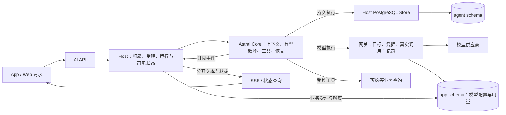

# AI Host 与模型网关架构

本文对应[产品设计文档](../心灵港湾-产品设计文档.md)中的 AI 聊天、模型配置、额度与限流。总体关系见[系统架构](01-总体架构.md)。

## 1. 职责关系

Host 管理一个业务会话对应的 Astral 会话及当前运行。Core 负责实际的模型执行流程。网关拥有供应商接入和调用记录，PG adapter 实现运行数据保存。三者都嵌入 Go 单体。

## 2. 一条消息如何执行

1. App 生成稳定的业务输入 ID，提交会话 ID 和文字。
2. Host 校验账号、会话归属、消息长度、AI 启用状态和发送频率。已经受理过的同一输入直接返回原回执。
3. Host 取得账号与全局运行名额，保存受理记录并扣除一次日额度。
4. Host 解析本次聊天用途配置，调用 Astral 接收输入。Core 持久化上下文与执行记录，再调用模型。
5. 网关在真正向供应商发请求时记录一次物理调用，返回文本增量、用量或错误。Core 处理需要的工具和自动重试。
6. Host 将可展示的文本和状态发给 App。完整回复由 Core Store 确认后进入正式历史。
7. 运行结束时 Host 更新业务状态、释放名额，并按成功、失败或主动停止处理额度。

Host 受理记录与 Core 的 Commit 各有事务。Core 拒绝前一步已经预留的请求时，Host 释放占用。进程重启后，用稳定输入 ID 查询 Core 回执，对齐已经接收、尚未接收和已结束的记录。

## 3. 发送、恢复、重试各代表什么

| 操作 | 运行含义 | 界面结果 |
| --- | --- | --- |
| 网络重发同一输入 | 查询已存在的受理回执 | 同一条用户消息，不再次生成 |
| SSE 断线重连 | 先订阅并暂存增量，再读取持久历史和快照并去重合并 | 恢复已经确认的内容和当前状态 |
| 用户停止 | 对指定运行发送 Cancel | 保留原输入，显示真实的已停止或已经完成状态 |
| 进程重启后的继续 | 恢复未完成执行，遵循 Core 可继续状态与冻结目标 | 继续同一业务输入，以新的 Core Run 恢复执行，不新增用户消息 |
| 用户主动重试 | 对最近一条未完成回答启动明确的重新生成操作 | 原用户输入只显示一次，出现新的执行尝试 |

`Continue` 用于 Core 表示可继续的执行。已经终止的失败或取消，Host 需要按保存的执行边界发起新的生成，不能把相同 Input.ID 再次提交当成重试。实现可使用 Core 的完整历史边界和分支能力，为原业务输入建立新的运行关联。旧尝试保留内部追踪，当前会话展示选定的有效历史。

同一会话只有一个活动句柄，同一账号只有一个在途生成。当前采用单 Go 实例，由进程内管理器持有句柄和并发槽，持久回执负责重启后的核查。

## 4. 模型网关

连接记录包含供应商、协议、地址、密钥和启用状态。用途配置把聊天、摘要、标题映射到具体连接和模型，并保存温度、上下文预算与输出上限。

网关在解析阶段选择目标，在实际模型出站阶段检查连接是否仍启用、取出凭据、执行请求并记录结果。固定快照保存连接与模型标识、配置版本和参数，密钥留在服务端。

新请求可以选择已配置的备用连接。正在执行的请求、Core 自动重试和未完成恢复保持原冻结目标。连接被停用时后续出站会被拒绝，返回可理解的业务错误。

当前 Core 存在 `Model.Stream` 与准备后的 `RequestExecution.Stream` 两条执行路径。网关要覆盖两条真实出站路径，模型估算与准备阶段不计为真实调用。每次实际出站生成独立调用 ID，记录用户、业务输入、用途、模型、状态、耗时及供应商返回的用量。

自动重试由 Core 统一控制，网关只执行当前这一次请求。默认最多两次尝试，每次四十五秒，整轮由 Host 设置九十秒总时限并主动取消。业务限额拒绝为不可自动重试错误，供应商暂态错误按策略处理。

## 5. 额度与用量

两类记录采用不同单位。

| 记录 | 按什么计数 | 用途 |
| --- | --- | --- |
| 用户日额度 | 被受理的逻辑用户输入 | 控制用户每日可使用次数 |
| 模型调用与用量 | 每次真实供应商请求 | 查看调用量、耗时、失败与 token |

默认每账号每日四十条、每分钟六条、一个在途生成，全局十个并发名额。具体值来自后台配置，日界线使用学校时区。

频率、额度或并发拒绝发生在受理前。取得一个聊天名额后，本轮回复、摘要与自动重试顺序复用，结束时释放。后台标题与连接测试也使用这一名额池，名额不足时标题保留默认名称、测试返回繁忙。

自动重试只增加供应商调用记录。整轮失败且没有完整回复时返还该次日额度，返还按对应受理记录幂等处理。主动停止保留已使用次数。用户随后明确重试时，若先前额度已经退还则重新占用，仍保留的次数可以继续复用。

成功、失败或取消后的供应商实报用量都需要记录。没有用量时保存未知状态。可配置价格用于估算费用，统计页面明确其为估算。

## 6. 持久化和事件出口

业务会话表只保存账号、标题、状态及 Astral 关联。运行历史、摘要、输入回执、模型尝试和提交回执由 Host PG adapter 保存到 `agent` schema。

### 增量保存与历史引用

同一个消息节点的正文只持久化一份。每轮新增本轮输入、回复和必要的工具结果，模型尝试记录保存历史边界、配置版本、消息选择、准备差异、结果节点引用及用量。完整模型请求在内存中按这些引用组装。

例如第 20 轮聊天新增第 20 轮的问题和回答，前 19 轮通过历史节点引用参与请求。普通重试保存新的尝试记录并复用冻结输入。摘要是新的内容节点，失败片段归所属 Attempt，均按自己的实际新增内容保存。

Host PG adapter 的分支投影与大字段也采用引用结构，避免把完整上下文作为一大段 JSON 在每次 Commit 中重新写入。网关调用日志保存 ID、目标、状态、耗时和用量，正文仍从 Store 按需重建。显式 Detached Fork 会复制所选历史，属于独立副本操作，普通聊天与自动重试使用已有历史引用。

### Store 和展示事件

PG adapter 实现 Core 公开 Store 接口，包括状态读取、输入回执、Attempt 查询、历史与待办分页、原子 Commit、Commit 回执和 Fork。Commit 在一个数据库事务内完成版本核验和相关写入。完整会话删除也由 Host 适配，删除前停止执行，再使业务入口与分享失效。

Core 的 `Subscribe` 提供实时事件，序号属于当前句柄。Host 只把用户可见文本、工具对应的业务卡片和运行状态发给客户端，内部提示、原始错误与推理不进入普通事件流。

建议 App 使用以下概念接口，最终字段集中到接口契约。

| 接口 | 含义 |
| --- | --- |
| `POST /ai/conversations/{id}/inputs` | 受理输入，返回业务输入 ID、运行 ID 和状态 |
| `GET /ai/conversations/{id}/messages` | 获取已确认历史 |
| `GET /ai/runs/{id}` | 查询运行快照 |
| `GET /ai/runs/{id}/events` | 订阅展示事件 |
| `POST /ai/runs/{id}/cancel` | 明确停止 |
| `POST /ai/inputs/{id}/retry` | 明确重新生成，使用独立重试请求 ID 去重 |

以上接口均位于 `/api/v1` 下并检查当前账号。App 以会话、运行和尝试标识绑定临时文本。重连时先建立订阅并暂存事件，再读历史与快照，按句柄内事件序号和持久 Entry ID 对齐后发送，避免在查询与订阅之间遗漏变化。恢复执行返回新的 Core Run ID，Host 更新其与业务输入的关联。只有已经提交的完整结果进入正式历史。

## 7. AI 业务工具

Host 注册受控工具，查询学校公开服务、可约人员、时段和本人预约。工具调用沿用普通 API 的业务 Service 和权限规则，操作者来自服务端会话。

创建预约、分享对话、请求人工联系等动作，通过客户端真实确认界面完成。用户确认后由业务 Service 写入状态。模型的说明可以帮助用户理解，页面上的业务结果以服务端记录为准。

模型配置调整、API 失败、额度耗尽均有明确状态。AI 暂不可用时，预约、人工交流、社区及历史查询继续由各自业务模块服务。

## 实现依据

当前核查的 Astral Core 提交为 `4e2310bd0d4a8a673c18f5aa4f9323c6287f6515`。公开存储、执行和事件契约可在该版本核对。参考 [Store 接口](https://github.com/oines/astral-core/blob/4e2310bd0d4a8a673c18f5aa4f9323c6287f6515/store.go)、[模型执行接口](https://github.com/oines/astral-core/blob/4e2310bd0d4a8a673c18f5aa4f9323c6287f6515/request_execution.go)和[运行说明](https://github.com/oines/astral-core/blob/4e2310bd0d4a8a673c18f5aa4f9323c6287f6515/README.md)。
